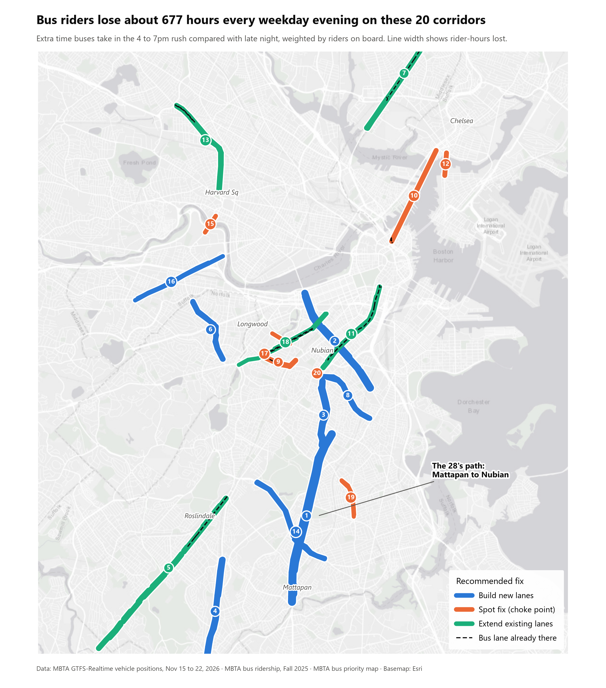

# Bus lane time-lapse: where Boston's buses lose time

Bus riders lose about 677 hours every weekday evening on 20 Boston-area corridors. I found those corridors by tracking every MBTA bus for a week, measuring where buses slow down at rush hour, and weighting that delay by how many riders are on board. I also tested whether bus lanes actually help (they do), and compared my list with the MBTA's own bus priority plans.



## Findings

- Bus lanes work. In the morning rush, buses in a lane lose about 12% of their late-night speed. Buses without one lose about 21%. A bootstrap puts the lane advantage at 8.7 points (95% range 1.4 to 16.6). The evening shows a similar gap, but with only 38 lane segments it isn't statistically certain.
- Blue Hill Ave and Warren St are the biggest problem. Together they make up the path of the 28 from Mattapan to Nubian, and buses there lose more than 110 rider-hours every weekday evening. The MBTA already has lanes planned there.
- 12 of my top 20 corridors are on the MBTA's planned or needed lists, which suggests the method finds real problems.
- 3 corridors already have lanes but are still among the worst: Broadway in Everett, Washington St in the South End, and Huntington Ave. The MBTA map counts them as done.
- 5 corridors are on no MBTA list: Dudley St, Tremont St in Mission Hill, the Tobin Bridge outbound, Ave Louis Pasteur in Longwood, and Malcolm X Blvd into Nubian. Three of them cluster around central Roxbury.

## How it works

1. Collect. `scripts/mbta_logger.py` saved the position of every MBTA bus every 15 seconds for a week (Nov 15 to 22, 2026) from the MBTA's public real-time feed. `scripts/wrap_up.py` converted the raw database to Parquet.
2. Prove the method on one route. [`01_route39_prototype`](notebooks/01_route39_prototype.ipynb) measures speeds along the 39 by hour of day and maps where it slows down.
3. Measure every segment and test the lanes. [`02_segments_and_lane_test`](notebooks/02_segments_and_lane_test.ipynb) times about 1.5 million stop-to-stop trips across 11,500 segments. It compares rush hour with late night and tags each segment by whether a bus lane runs in the bus's direction. Then it tests whether lanes hold speed better.
4. Weight by riders and rank corridors. [`03_corridors_and_recommendations`](notebooks/03_corridors_and_recommendations.ipynb) multiplies delay by riders on board (MBTA ridership data). It groups segments into connected street corridors, compares them with the MBTA's plans, and sorts the top 20 into three kinds of fix: new lanes, extending existing lanes, or spot fixes at choke points.
5. Animate. `scripts/export_for_blender.py` exports bus positions, route shapes with hourly slowdown, and the top corridors for a Blender animation (in progress). Act 1 plays a full weekday from 5am to 10pm, with every bus moving and streets glowing red as they slow. Act 2 resolves to the top 20 map.

## Tools

Python, DuckDB (SQL with window functions and ASOF joins), pandas, shapely, pyproj, matplotlib, Blender with Geometry Nodes.

## Data

- MBTA GTFS-Realtime vehicle positions (public feed, no key needed)
- MBTA GTFS schedule (stops, routes, shapes)
- MBTA bus ridership by trip and stop, Fall 2025 (MassDOT open data)
- MBTA bus lane and bus priority layers (MBTA public ArcGIS map)

Data files aren't in this repo because they're too large. Run the logger to collect your own week, then the notebooks in order.

## Limits

- One week of data, the week before Thanksgiving.
- Ridership is from Fall 2025, a year older than the bus data.
- Only 38 segments have a bus lane in the bus's direction, so the lane test is small.
- The MBTA's bus priority layers can mean signals or queue jumps as well as lanes.

## Run it yourself

```
python scripts/mbta_logger.py           # let it run for a week
python scripts/wrap_up.py               # database to Parquet
# run notebooks 01, 02, 03 in order
python scripts/export_for_blender.py    # files for the Blender importers
```
